# Anti Money Laudering Transaction Dataset (SAML-D)

Link: https://www.kaggle.com/datasets/berkanoztas/synthetic-transaction-monitoring-dataset-aml/data

## Estrutura

O dataset SAML-D possui aproximadamente **9,5 milhões de transações**, **12 colunas** e cerca de **9.873 registros positivos de lavagem de dinheiro** (~0,104% do conjunto).

| Coluna                 |             O que representa             |                                               O que estudar |
| :--------------------- | :--------------------------------------: | ----------------------------------------------------------: |
| Time                   |         Horário da transação         |                Conversão para horário e análise temporal |
| Date                   |           Data da transação           |                              Datas, períodos e ordenação |
| Sender_account         |             Conta remetente             |                       Recorrência e comportamento de envio |
| Receiver_account       |           Conta destinatária           |                 Recorrência e comportamento de recebimento |
| Amount                 |           Valor da transação           |               Distribuição, assimetria e valores extremos |
| Payment_currency       |            Moeda do pagamento            |                                     Variáveis categóricas |
| Received_currency      |              Moeda recebida              |                          Conversões e diferenças de moeda |
| Sender_bank_location   |   Localização bancária do remetente   |                             Comparações por localização |
| Receiver_bank_location | Localização bancária do destinatário |                            Operações entre localizações |
| Payment_type           |            Tipo de pagamento            |                                     Frequências e padrões |
| Is_laundering          |     Indicador de lavagem de dinheiro     |                         Variável-alvo para classificação |
| Laundering_type        |    Tipo de comportamento identificado    | Análise das categorias, com cuidado para não vazar o alvo |

## Resultados da Machine Learning

### Leitura Inicial

- **Timestamps inválidos:** 0
- **Dimensões:** (9504852, 10)
- **Taxa de lavagem:** 0.1039%
- **Período:** 2022-10-07 10:35:19 -> 2023-08-23 10:57:12

A principal característica do dataset é o **desbalanceamento de classes**. De aproximadamente 9.5 milhões de transações, apenas 9.873 estão identificadas como lavagem de dinheiro. Isso significa que o modelo precisa aprneder a reconhecer um comportamento muito raro entre milhões de transações normais.

Por isso, a acurácia pode ser enganosa, já que um modelo que prevê todas que todas as transações são normais já alcançaria 99,896% de acurácia.

### Separação Temporal

|             | **Linhas** | **Suspeitas** | **Taxa %** |
| :---------- | :--------------: | :-----------------: | :--------------: |
| Treinamento |     6653396     |        6764        |     0.101662     |
| Validação |     1425728     |        1412        |     0.099037     |
| Teste       |     1425728     |        1697        |     0.119027     |

**Amostra de treino:** (500000, 18) | positivas: 486
**Amostra de CV:** (200000, 18) | positivas: 202

**Observações:** A separação simula uma situação mais próxima da realidade:

- O modelo aprende com transações antigas.
- Os parâmetros e limiares são avaliados em transações posteriores.
- O desempenho final é medido em transações ainda não utilizadas.

A taxa de lavagem no teste é maior do que no treinamento. Isso é importante porque a proporção de casos positivos influencia diretamente as métricas como a precisão e PR-AUC e é um sinal para investigar se houve alguma mudança temporal no comportamento das transações.

### Pré-Processamento: Escalonadores e PCA

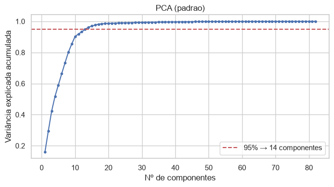

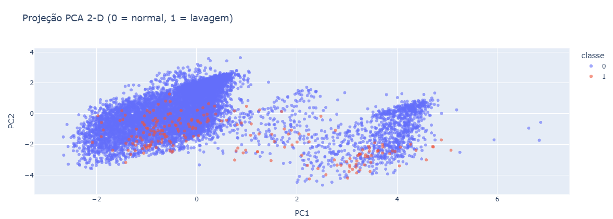

### Experimentos

#### 1. Escalonadores e PCA na Regressão Logística

Validação cruzada na amostra `X_cv`:

Cross Validation | Padrão           | 66.6s |
Cross Validation | MinMax           | 39.8s |
Cross Validation | Padrão + PCA(14) | 8.4s  |
Cross Validation | MinmAX + PCA(14) | 7.7s  |

**Métricas**

| Modelos           | Média da Precisão | Média da Recall | Média da F1_score | Média da PR_AUC | Desvio Padrão da PR_AUC |
| :---------------- | :-----------------: | :--------------: | :----------------: | :--------------: | :----------------------: |
| Padrão           |      0.009753      |     0.833488     |      0.019261      |     0.050841     |         0.040707         |
| MinMax            |      0.009732      |     0.833488     |      0.019219      |     0.044947     |         0.040952         |
| Padrão + PCA(14) |      0.005787      |     0.831944     |      0.011467      |     0.037820     |         0.021578         |
| MinMax + PCA(14)  |      0.005458      |     0.777155     |      0.010809      |     0.008903     |         0.003004         |

- **Padrão (StandardScaler):** transforma as variáveis numéricas para uma escala baseada na média e no desvio padrão.
- **MinMaxScaler:** transforma os valores para uma faixa definida, normalmente 0 e 1.

O **PCA** reduziu o número de dimensões para **14 componentes**, mas prejudicou o desempenho da `LogisticRegression`.

O PCA tenta preservar a variância dos dados, não necessariamente as informações mais relevantes para distinguir lavagem de dinheiro de transações normais. Reduzir a dimensionalidade não significa automaticamente melhorar o modelo, como foi visto com a `LogisticRegression`.

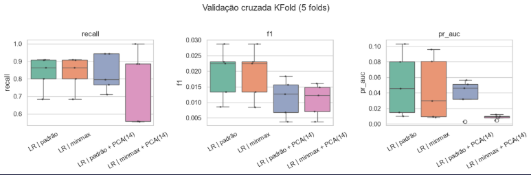

#### 2. Validação Cruzada de KFold dos Modelos

Cross Validation | DummyClassifier        | 66.6s |
Cross Validation | LogisticRegression     | 39.8s |
Cross Validation | RandomForestClassifier | 8.4s  |
Cross Validation | LightGBM               | 7.7s  |

**Total de Transações Positivas**

|                 Modelo | Total de Positivas |
| ---------------------: | -----------------: |
|        DummyClassifier |                202 |
|               LightGBM |                202 |
|     LogisticRegression |                202 |
| RandomForestClassifier |                202 |

**Métricas**
| Modelos                | Média da Acurácia   | Média da Precisão | Média da Recall | Média da F1_score | Média da PR_AUC | Desvio Padrão da PR_AUC |
| :--                    | :--:     | :--:     | :--:     | :--:      | :--:     |
| LightGBM               | 0.999600	| 0.862924 | 0.657518 | 0.729346  | 0.716789 | 0.284833 |
| RandomForestClassifier | 0.999170	| 0.925000 | 0.196315 | 0.318983  | 0.582783 | 0.259566 |
| LogisticRegression     | 00.904815| 0.009753 | 0.833488 | 0.019261  | 0.050841 | 0.040707 |
| DummyClassifier        | 0.998990	| 0.000000 | 0.000000  | 0.000000 | 0.001010 | 0.000124 |

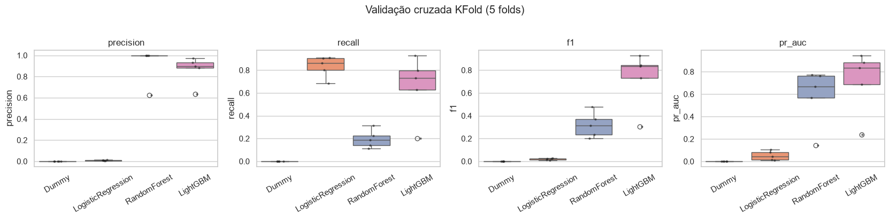

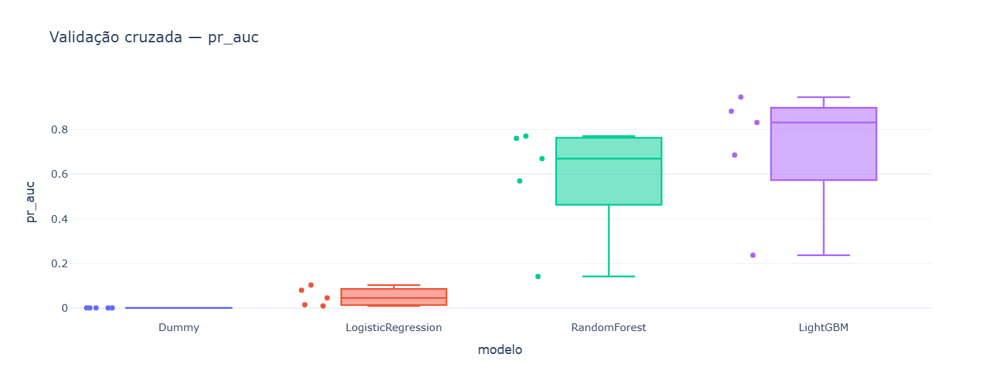

#### 3. Treinamento Final e Avaliação na Validação

**DummyClassifier**

|                  | Precisão | Recall | F1-score | Suporte |
| :--------------- | :-------: | :----: | :------: | :-----: |
| Normal           |  0.9990  | 1.0000 |  0.9995  | 1424316 |
| Lavagem          |  0.0000  | 0.0000 |  0.0000  |  1412  |
|                  |          |        |          |        |
| Acurácia        |          |        |  0.9990  | 1425728 |
| Média Macro     |  0.4995  | 0.5000 |  0.4998  | 1425728 |
| Média Enviesada |  0.9980  | 0.9990 |  0.9985  | 1425728 |

Matriz de Confusão:
[[1424316    0]
[     142   0]]

**LogisticRegression**

|                  | Precisão | Recall | F1-score | Suporte |
| :--------------- | :-------: | :----: | :------: | :-----: |
| Normal           |  0.9999  | 0.9138 |  0.9549  | 1424316 |
| Lavagem          |  0.0103  | 0.9072 |  0.0204  |  1412  |
|                  |          |        |          |        |
| Acurácia        |          |        |  0.9138  | 1425728 |
| Média Macro     |  0.5051  | 0.9105 |  0.4877  | 1425728 |
| Média Enviesada |  0.9989  | 0.9138 |  0.9540  | 1425728 |

Matriz de Confusão:
[[1301521  122795]
[    131    1281]]

**RandomForestClassifier**

|                  | Precisão | Recall | F1-score | Suporte |
| :--------------- | :-------: | :----: | :------: | :-----: |
| Normal           |  0.9995  | 0.9999 |  0.9997  | 1424316 |
| Lavagem          |  0.7903  | 0.4858 |  0.6018  |  1412  |
|                  |          |        |          |        |
| Acurácia        |          |        |  0.9994  | 1425728 |
| Média Macro     |  0.8949  | 0.7429 |  0.8007  | 1425728 |
| Média Enviesada |  0.9993  | 0.9994 |  0.9993  | 1425728 |

Matriz de Confusão:
[[1424134     182]
[    726     686]]

**LightGBM**

|                  | Precisão | Recall | F1-score | Suporte |
| :--------------- | :-------: | :----: | :------: | :-----: |
| Normal           |  0.9999  | 0.9990 |  0.9995  | 1424316 |
| Lavagem          |  0.4876  | 0.9341 |  0.6408  |  1412  |
|                  |          |        |          |        |
| Acurácia        |          |        |  0.9990  | 1425728 |
| Média Macro     |  0.7438  | 0.9666 |  0.8201  | 1425728 |
| Média Enviesada |  0.9994  | 0.9990 |  0.9991  | 1425728 |

Matriz de Confusão:
[[1422930    1386]
[     93    1319]]

|                        | Acurácia | Precisão | Recall | F1-score | PR_AUC | Tempo de Treinamento |
| :--------------------- | :-------: | :-------: | :----: | :------: | :----: | :------------------: |
| LightGBM               |  0.9990  |  0.4876  | 0.9341 |  0.6408  | 0.9167 |        7.4099        |
| RandomForestClassifier |  0.9994  |  0.7903  | 0.4858 |  0.6018  | 0.6896 |       15.8335       |
| LogisticRegression     |  0.9138  |  0.0103  | 0.9072 |  0.0204  | 0.1102 |       31.8517       |
| DummyClassifier        |  0.9990  |  0.0000  | 0.0000 |  0.0000  | 0.0010 |        0.0720        |

**Matriz de Confusão**
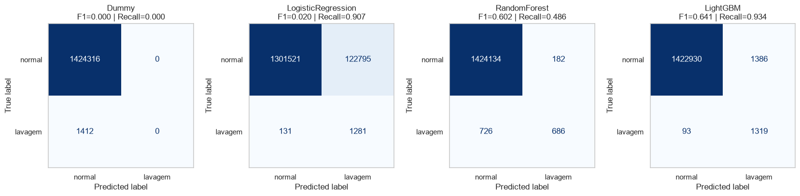

**Curva de Precisão x Recall**
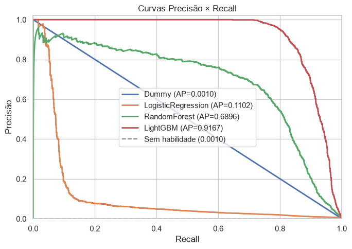

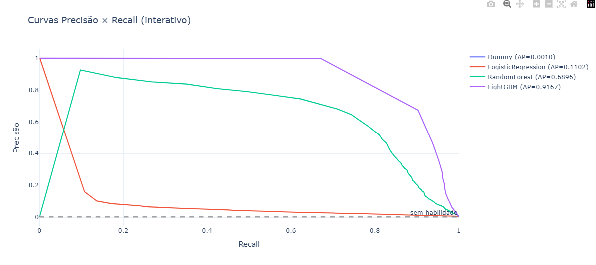

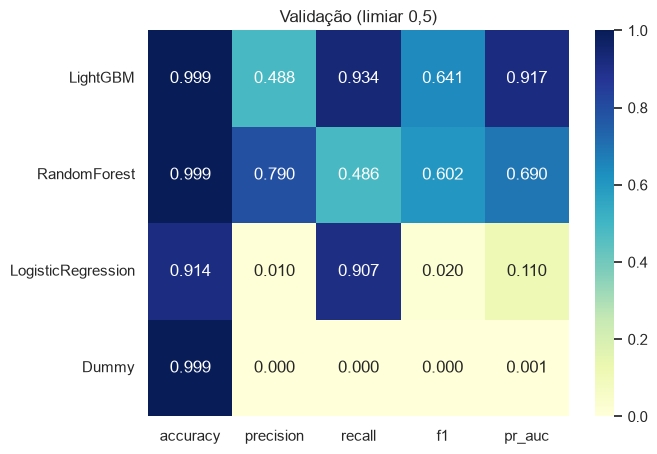

**Comparação dos Modelos**
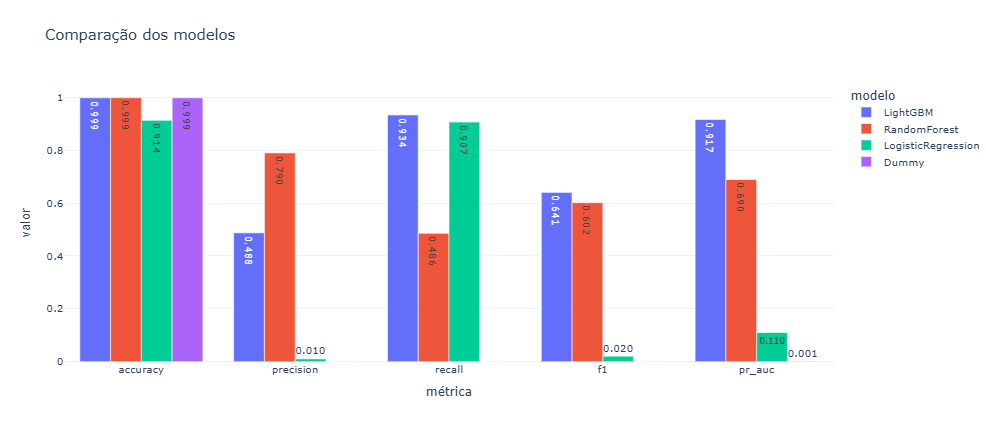

**1. DummyClassifier - Modelo de Referência**
O `DummyClassifier` não tenta encontrar padrões complexos nos dados. Aqui, ele prevê a classe mais frequente, a transação normal, por isso não identificou nenhuma transação de lavagem. Mesmo assim, a sua acurácia é próxima de 99,9%.

Sua função é servir como referência para provar que os outros modelos realmente aprenderam algo útil.

**2. LogisticRegression - Alta Detecção e Baixa Precisão**

- **Recall: 0,8335** -> Indica que consegue identificar uma parte considerável das transações positivas.
- **Precisão: 0,00975** -> Sendo muito baixa, entre as transações que o modelo sinaliza como suspeitas, poucas realmente pertencem à classe positiva (falsos positivos).

Sua função é ser uma referência de modelo linear, mas os resultados indicam suas limitações ao trabalhar com o SAML-D.

**3. RandomForestClassifier - Maior Precisão e Baixo Recall**

Aqui ocorre o oposto da `Logistic Regression`.

- **Recall: 0,1963** -> Ao identificar uma transação como suspeita, geralmente está correto. Mas, consegue identificar apenas aproximadamente **19,6% das transações positivas** na validação cruzada, deixando passar cerca de **80,4% dos casos positivos**.

É interessante se o objetivo for gerar poucos alertas, com maior confiabilidade, mas não seria o mais ideal para detectar o mairo número possível de casos.

**LightGBM - Equilíbrio**

- Teve uma precisão relativamente alta (0,8629%) com um recall melhor (0,6575) que o `RandomForestClassifier`. Isso significa que identifica mais casos positivos sem gerar tantos falsos alertas.
- **Desvio padrão da PR-AUC: 0,2848** -> Indica instabilidade entre os **folds da validação cruzada**, que ocorre por causa do desbalanceamento extremo, diferença na distribuição dos dados e varição temporal. O desempenho pode variar bastante dependendo de quais transações estão em cada divisão.

O `LightGBM` foi o melhor dos quatro modelos na validação cruzada, mas é preciso investigar a variabilidade dos resultados.

**Análise das Matrizes de Confusão**

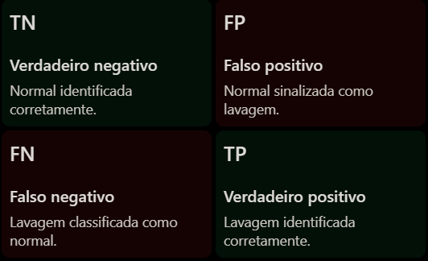

- **`LogisticRegression`:** Identificou 1.281 das 1.412 transações positivas, gerando 122.795 falsos positivos.
- **`RandomForestClassifier`:** Gerou apenas 182 faslos positivos, mas deixou passar 726 das 1.412 transações positivas.
- **`LightGBM`:** Identificou 1.319 das 1.412 das transações positivas, deixando passar 93. Mas, gerou 1.386 falsos positivos.

| Indicador                  | RandomForestClassifier | LightGBM |
| :------------------------- | :--------------------: | :------: |
| Fraudes identificadas      |          686          |  1.319  |
| Fraudes não identificadas |          726          |    93    |
| Falsos alertas             |          182          |  1.386  |
| Precisão                  |         79,03%         |  48,76%  |
| Recall                     |         48,58%         |  93,41%  |

Aqui aparece claramente o trade-off:

- `RandomForestClassifier`: menos alertas, mas deixa passar muitas transações positivas.
- `LightGBM`: encontra mais transaçõs positivas, mas exige mais investigação dos alertas gerados.

Nenhum dos dois é automaticamente melhor para todas as aplicações. Depende do custo de deixar uma fraude passar e do custo de investigar uma transação normal.

#### 4. Escolha do Limiar na Validação e Resultado Final no Teste

**Limar** (Threshold) é o valor mínimo de uma pontuação ou probabilidade que o modelo precisa atingir para classificar um registro como pertencente a determinada classe.

LogisticRegression   melhor F1 @ 0.9986 (F1=0.137) | recall≥80% @ 0.7880 (precisão=0.019)
RandomForest         melhor F1 @ 0.3841 (F1=0.699) | recall≥80% @ 0.3187 (precisão=0.543)
LightGBM             melhor F1 @ 0.9420 (F1=0.870) | recall≥80% @ 0.9492 (precisão=0.951)

|                        | Acurácia | Precisão | Recall | F1-score | PR_AUC |
| :--------------------- | :-------: | :-------: | :----: | :------: | :----: |
| LightGBM               |  0.9997  |   0.901   | 0.8362 |  0.8674  | 0.9200 |
| RandomForestClassifier |  0.9993  |   0.710   | 0.7560 |  0.7323  | 0.7396 |
| LogisticRegression     |  0.9988  |   0.480   | 0.1131 | 0.01831 | 0.1823 |
| DummyClassifier        |  0.9988  |  0.0000  | 0.0000 |  0.0000  | 0.0012 |

**Trade-off do Limiar - LightGBM**
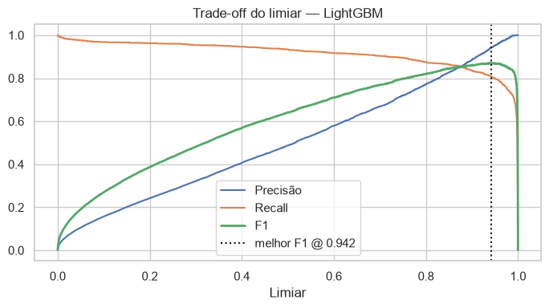

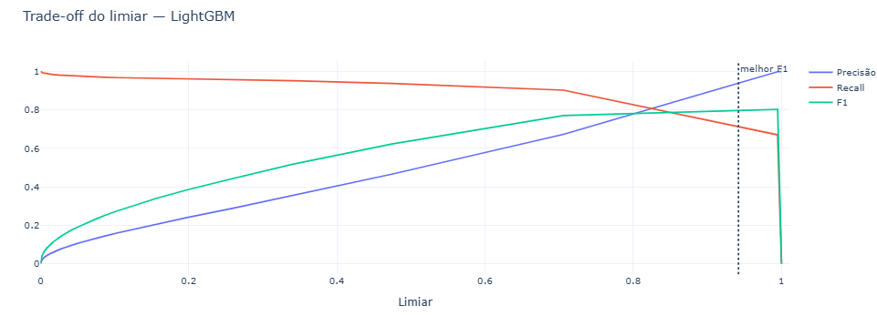

**Matriz de Confusão**
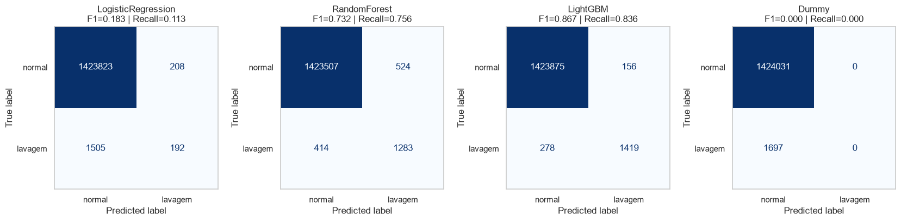

**Curvas de Precisão x Recall**
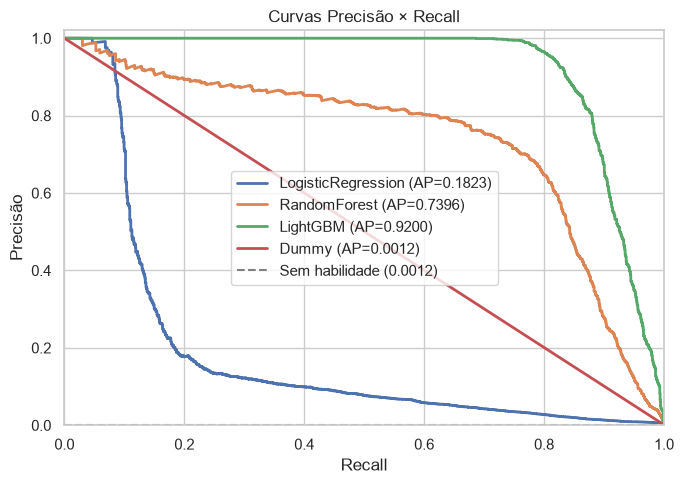

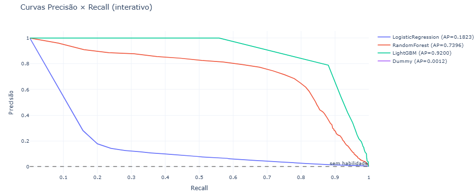

**Matriz de Confusão**
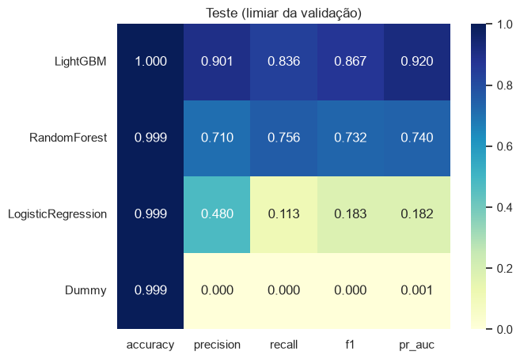

|                  | Precisão | Recall | F1-score | Suporte |
| :--------------- | :-------: | :----: | :------: | :-----: |
| Normal           |  0.9998  | 0.9999 |  0.9998  | 1424031 |
| Lavagem          |  0.9010  | 0.8362 |  0.8674  |  1697  |
|                  |          |        |          |        |
| Acurácia        |          |        |  0.9997  | 1425728 |
| Média Macro     |  0.9504  | 0.9180 |  0.9336  | 1425728 |
| Média Enviesada |  0.9997  | 0.9997 |  0.9997  | 1425728 |

#### 5. Importância dos Atributos

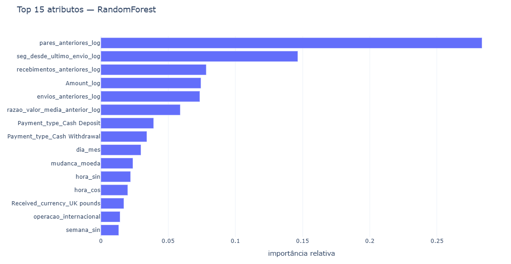

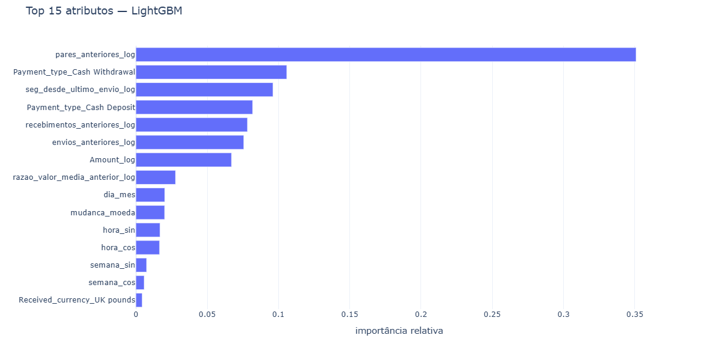

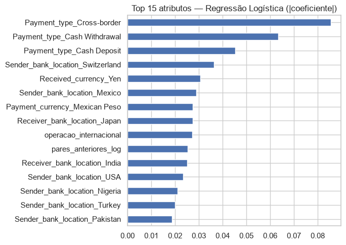
